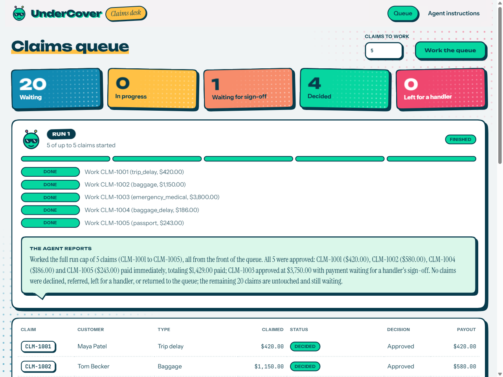
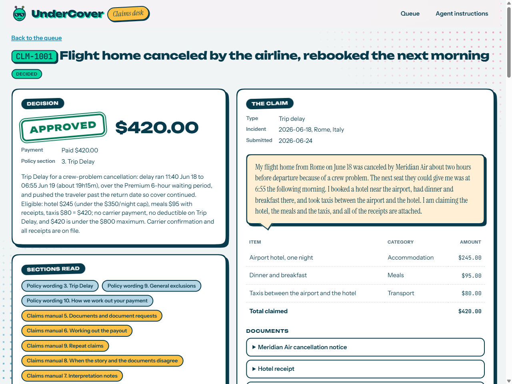

# Jeff Lenamon: the harness, with a pop-art dashboard

My build of the pilot and the Week 1 Day 5 harness, with the dashboard redrawn as a comic panel. I directed and reviewed; Claude Code planned and built the pilot and the harness from the briefs in `docs/`, and the redesign from my own request.

**Code:** https://github.com/lenamonj/undercover/tree/jeff-lenamon-build

| The queue after a run of five | A claim, stamped |
| --- | --- |
|  |  |

## What I built

- **The pilot and the harness**, each from a written plan with checkbox criteria (`docs/PLAN.md`, `docs/PLAN_HARNESS.md`), committed phase by phase.
- **A queue agent** that writes its own to-do list and hands each claim to a fresh claim agent. The backend enforces the cap on a run, the two-attempt limit and the check for missed claims.
- **A pop-art dashboard** in the brand's five colors: thick outlines, hard shadows and halftone dots. A decision lands as a rubber stamp, the customer's story and the agent's report are speech bubbles, and the agent is an alien in sunglasses that bobs while it works.
- **Page changes with React 19.3's `<ViewTransition>`**: a claim's id flies from its row in the queue to the top of its page.

A live run capped at five on DeepSeek V4.1 Flash worked five claims in under a minute. It approved all five and held the one payout over $1,000 for sign-off. I did not score it against the evals.

## Takeaways

- Put the rules in the backend. The claim agent calls `pay_claim` after every approval, and the API refuses a payout over $1,000 until a handler signs off. In the live run it refused CLM-1003's $3,750.00, and the claim waited for sign-off.
- End-to-end tests earn their keep. One caught the dashboard going quiet the moment a claim was decided, before the payment and the agent's last reply. The unit tests had passed.
- Keep the model key away from the tests. One of mine started a real run with the key from `.env`, so the Python tests and the end-to-end server now remove it, and the end-to-end tests run a scripted model.
- Let the linter tell you what is current. It flagged React Router's `viewTransition` prop as deprecated, which led to React's own component.
