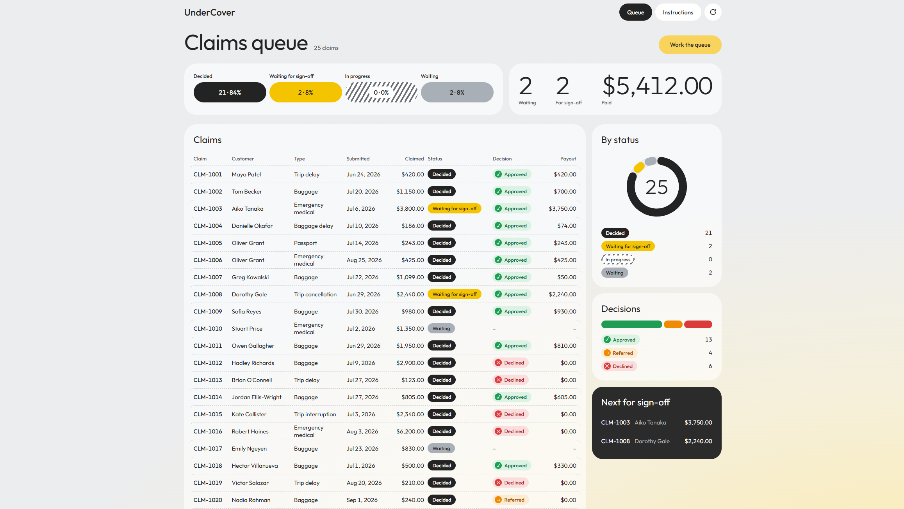
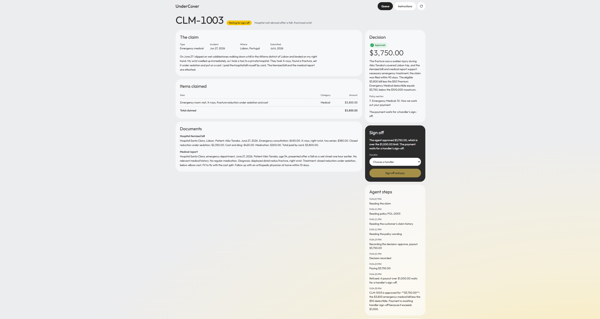

# Pilot: Travel Insurance Claims Agent — omotsart

**My project:** https://github.com/omotsart/undercover/tree/oleg-pilot

## What I changed: the interface

The core works as in the course. My own part was a redesign of the frontend.

1. **New visual style.** I designed the screens first as mockups, then wrote the
   style down in `BRAND.md`: the Outfit font, a calm Graphite / Sunflower / Stone
   palette, rounded cards without outlines, and dashed row separators.
2. **Colors only for decisions.** Green, orange and red are used only for claim
   outcomes. That way a reviewer sees approved, pending and declined claims at a
   glance, and color never means anything else.
3. **Queue overview at the top.** Four status pills show counts and percentages,
   with hatching for "in progress". A ring chart shows the proportions and total.
4. **Clickable rows.** The row under the mouse lifts with a white background and a
   soft shadow, and the whole row opens the claim. The same highlight works with
   the Tab key.

**Why:** the person who signs off claims spends the whole day in the queue. The
screen should show the state of work in a second and make the claims that need a
human stand out.

## What I learned

- My first `BRAND.md` described colors and components but no sizes or layout.
  The coding agent filled the gaps with its own defaults: tiny text, a stretched
  page and faded statuses. Once I added a type scale, page width and every
  status, the result matched the mockup. A spec for an agent has to cover what
  you take for granted.
- Designing the screen first and handing the agent a written style worked much
  better than describing the look in a prompt.
- Taste is the part I could not delegate: the agent built what I asked for,
  but deciding what the reviewer needs to see was my job.
