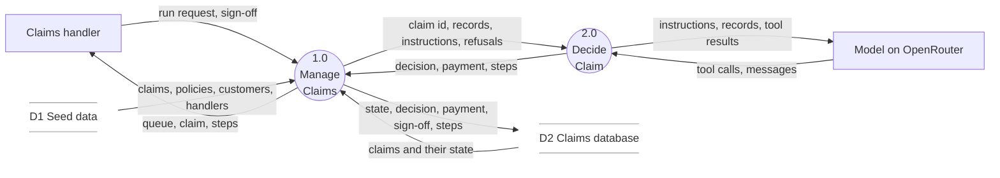
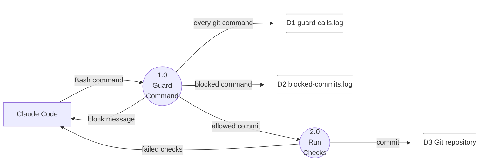

# The UnderCover pilot, built from its plan

This comes from Ed Donner's Udemy course, [AI FDE: The Forward Deployed Engineer & Agentic AI Architect](https://www.udemy.com/course/ai-fde-forward-deployed-engineer-agentic-ai-architect/). In the Week 1 Day 3 build, I am UnderCover's forward deployed engineer (FDE), and I direct a coding agent, Claude Code. It plans the pilot from the customer's documents, I review the plan, it builds the plan phase by phase, and I review the result.

My build: https://github.com/dallaire44/undercover/tree/week1day3-redo

The plan it implemented is [PLAN.md](PLAN.md), a copy of `docs/PLAN.md`.

- [The UnderCover pilot, built from its plan](#the-undercover-pilot-built-from-its-plan)
  - [What was built](#what-was-built)
  - [The commit path](#the-commit-path)
  - [My takeaways](#my-takeaways)
    - [KO the Code Slop](#ko-the-code-slop)
  - [Appendix: the diagrams](#appendix-the-diagrams)
    - [The /dfd-mermaid skill](#the-dfd-mermaid-skill)
    - [Diagram 1: the pilot](#diagram-1-the-pilot)
    - [Diagram 2: the commit path](#diagram-2-the-commit-path)

## What was built

UnderCover Travel Insurance is a fictional travel insurer. Its three claims handlers work through a queue of 25 claims by hand. The pilot gives them the UnderCover Agent, which decides claims, and a dashboard to see its work.

Four choices in the plan shape it:

- **The backend owns the rules.** A payout over $1,000 can't be paid until a handler signs off. `pay_claim` enforces this, not the prompt, so it holds however the agent behaves.
- **The agent works only through the API.** Each of its six tools is one backend call, and it fetches its instructions from the API. It can't reach what the API doesn't expose, such as a customer's contact details or `data/evals/`.
- **The agent reports each step.** Every message, tool call and tool result is posted to the backend, and the dashboard polls them while the agent works.
- **The backend starts the agent.** "Run the agent" and "Work the queue" in the dashboard call the backend, which runs the agent in a background task.

1.0 is the FastAPI and SQLite backend with its React dashboard. 2.0 is the agent, LangChain's `create_agent`. D1 is `data/`, copied into SQLite on first start; `data/evals/` and `data/security/` are never loaded.

Each phase had its own success criteria (75 in all), was built with tests, and ended in one commit through the pre-commit hook. Phases 7 and 8 are my additions. Each went into the customer's documents first (`docs/SPEC.md`, then a new `docs/ACCESSIBILITY.md`), then became a phase with success criteria.

| Phase                                      | What it built                                                                                                                                                                       | Criteria |
| ------------------------------------------ | ----------------------------------------------------------------------------------------------------------------------------------------------------------------------------------- | -------- |
| 0. The commit guard                        | A Claude Code `PreToolUse` hook that blocks `--no-verify`, `git commit -n`, `LEFTHOOK=0` and `core.hooksPath`, and logs every git command it sees                                   | 5        |
| 1. The records and the queue               | The SQLite database seeded from `data/`, the seven read operations, and the agent's instructions in `backend/instructions.md`                                                       | 13       |
| 2. Decisions, payments, sign-off and steps | The payment rules: an approval over $1,000 waits for sign-off, and `pay_claim` refuses it with HTTP 409 until a handler signs off                                                   | 11       |
| 3. The UnderCover Agent                    | `create_agent` with six tools. The backend runs it on one claim or the whole queue, and puts a claim back to waiting if a run ends without a decision                               | 10       |
| 4. The dashboard: the queue and the claim  | React, Vite and TypeScript in UnderCover's brand: the state counts, the eight-column queue and each claim in full. Playwright gets its own backend and database                     | 6        |
| 5. The dashboard: the agent at work        | "Run the agent", "Work the queue", the agent's steps as a timeline, the sign-off panel and the read-only instructions                                                               | 6        |
| 6. End to end, and handover                | The real agent run from the dashboard on CLM-1001, CLM-1013, CLM-1004 and CLM-1003, checking that a payout over $1,000 waits for sign-off. `docs/STATUS.md` and `README.md` updated | 6        |
| 7. A light and dark slider (mine)          | A "Dark mode" switch on every page. The mode is one attribute on `<html>`, set before the page draws, so the wrong mode never flashes                                               | 8        |
| 8. A color-blind mode (mine)               | A second switch that moves the state and decision colors to the Okabe-Ito palette and adds a check, cross or arrow to each decision                                                 | 10       |

At the end, the checks hold 42 pytest tests (98% coverage), 41 vitest tests (99%) and 26 Playwright tests, with Ruff, pyright, ESLint, Prettier and tsc on top.

This branch is a second run of the same plan: the first build's code was removed and its criteria unticked, then Claude Code built it again.

## The commit path

Phase 0 comes first, so that the later commits go through the guard as well as the pre-commit checks.

1.0 is the guard, `.claude/hooks/guard-commit.mjs`. Claude Code runs it before every Bash command. It logs each git command, and blocks a bypass with exit code 2. 2.0 is Lefthook. It formats the staged files, then runs the checks for the part that changed: Ruff, pyright and pytest for Python, and Prettier, ESLint, tsc and vitest for TypeScript. A failed check refuses the commit, and Claude fixes it and commits again.

The guard wasn't loaded until the next Claude Code session, so it saw every commit from Phase 3 on. Phases 0 to 2 went through Lefthook alone.

## My takeaways

### KO the Code Slop

Worried about the technical debt time bomb that code slop will detonate? You should be!

Ed Donner's Udemy course, AI FDE: The Forward Deployed Engineer & Agentic AI Architect, teaches you how to defuse it.

How? Ed's Agentic Development Lifecycle (ADLC), an evolving discipline built on three layers:

- **Platform/Harness:** state, memory, skills, integrations, sub-agents, agent teams
- **Process/Harden:** hooks, linters, CI/CD, sandboxes, gateways, tests, evals
- **People/Humans (you):** named accountability, meaningful review, ownership end to end

The course's UnderCover project shows the Process/Harden layer before any LLM is called. The repo ships with [Lefthook](https://github.com/evilmartians/lefthook), an open-source git hooks manager from Evil Martians. On every commit that touches code, it runs formatters, linters (Ruff, Prettier, ESLint), type checkers (pyright, tsc) and unit tests with an 80% coverage gate. No LLM involved. The human sets the guardrails first; the agent works inside them.

Claude Code triggers it like anyone else: commit, fix, commit again.

Can the agent skip it? Yes. As Ed points out, it could commit with a flag that bypasses the hook. Digging further, I found more ways: `LEFTHOOK=0`, changing `core.hooksPath`, deleting the hook, or editing `lefthook.yml` to drop a job.

So, three rounds of defence:

- **Round 1, the instruction:** the project's `PROCESS.md` tells Claude never to use `--no-verify`.
- **Round 2, the guard:** I added a Claude Code PreToolUse hook that checks every command before it runs and blocks bypasses. It logs every git command it checks, so I can see it working. It fired even in auto permission mode. A guard on the guard, at about 10 to 20 ms per command.
- **Round 3, CI:** Ed adds generic CI in a later session. My takeaway: have it call the same checks the hook runs, on a server where nothing on the local machine can skip them.

None is perfect alone. Claude could hide a commit inside a script the hook can't read, or edit the hook if bypassPermissions mode is on. CI only holds with branch protection and a human reviewing changes to the workflow.

In my UnderCover run, the guard checked 16 git commands and passed 7 commits. It blocked twice: once on a deliberate `--no-verify` test, once on a false alarm, a plan edit that merely mentioned the flag. No real bypass attempts, and Lefthook refused none of the commits.

The agents write the code. You own what ships.

What guardrails do you put around your coding agents?

## Appendix: the diagrams

### The /dfd-mermaid skill

Both diagrams were drawn by Claude Code with `/dfd-mermaid`, a Claude Code skill in my skills folder (`~/.claude/skills/dfd-mermaid/SKILL.md`). A skill is a file of instructions that Claude Code loads when a task matches its description, or when it is typed as a slash command. This one has Claude draw data flow diagrams (DFDs) in the Yourdon/DeMarco notation, always with the same Mermaid pattern, so every diagram looks the same and follows the notation's rules. The skill fixes the shapes and the rules. What goes in each diagram came from `docs/PLAN.md` and the code.

A DFD shows what data moves where, not the order things happen in. It has four kinds of element:

| Shape                     | Element         | Meaning                                                                       |
| ------------------------- | --------------- | ----------------------------------------------------------------------------- |
| Rectangle                 | External entity | A person or system outside the part being drawn, which sends or receives data |
| Circle, numbered 1.0, 2.0 | Process         | Something that takes data in and sends data out                               |
| Two parallel lines        | Data store      | Data at rest                                                                  |
| Labeled arrow             | Data flow       | The data that moves, named on the arrow                                       |

The skill holds Claude to the notation's rules:

- Every arrow is labeled with the data it carries.
- Data moves only through a process: never from entity to entity, entity to store, or store to store.
- A diagram with three or more processes is split into one diagram per process, with an index. Both diagrams here have two processes, so each stays whole.
- Diagrams run left to right unless a vertical one is asked for.

Mermaid has no parallel-line shape, so the skill draws a store as a borderless box between two horizontal lines. The skill targets VS Code's Markdown Preview Enhanced; other viewers may draw those lines differently.

### Diagram 1: the pilot

| Element             | Kind            | In the build                                                                                                                     |
| ------------------- | --------------- | -------------------------------------------------------------------------------------------------------------------------------- |
| Claims handler      | External entity | One of UnderCover's three handlers, using the dashboard                                                                          |
| Model on OpenRouter | External entity | The LLM the agent calls                                                                                                          |
| 1.0 Manage Claims   | Process         | The FastAPI backend and the React dashboard. It serves the queue and the claims, enforces the payment rules and starts the agent |
| 2.0 Decide Claim    | Process         | The UnderCover Agent, `create_agent` with six tools                                                                              |
| D1 Seed data        | Data store      | `data/`, copied into SQLite on first start                                                                                       |
| D2 Claims database  | Data store      | `undercover.db`: the claims, decisions, payments, sign-offs and steps                                                            |

What it shows:

- 2.0 has no arrow to D2. The agent never writes to the database itself; every decision and payment goes through 1.0, where the rules are.
- "Refusals" flow from 1.0 back to 2.0. When the agent tries to pay over $1,000 without a sign-off, the backend refuses, and the agent sees why.
- The model sees only what 2.0 sends it: the instructions, the records it fetched and the tool results.

To keep two processes, 1.0 combines the backend and the dashboard. Drawing them apart would make three processes, and the skill would split the diagram into three.

### Diagram 2: the commit path

| Element                | Kind            | In the build                                                                      |
| ---------------------- | --------------- | --------------------------------------------------------------------------------- |
| Claude Code            | External entity | The coding agent, running Bash commands                                           |
| 1.0 Guard Command      | Process         | The `PreToolUse` hook, `.claude/hooks/guard-commit.mjs` (Round 2 in my takeaways) |
| 2.0 Run Checks         | Process         | Lefthook's pre-commit hook                                                        |
| D1 guard-calls.log     | Data store      | `~/.claude/guard-calls.log`: every git command, with `blocked` true or false      |
| D2 blocked-commits.log | Data store      | `~/.claude/blocked-commits.log`: blocked commands only                            |
| D3 Git repository      | Data store      | The repo's commit history                                                         |

What it shows:

- A commit reaches D3 only through both processes: the guard, then the checks.
- Claude gets two kinds of refusal: the guard's block message, and the failed checks.
- The "allowed commit" arrow is a simplification. The guard doesn't pass the commit on; it exits without blocking, Claude Code runs the command, and git calls Lefthook.
- The diagram shows the path as designed. The bypasses in my takeaways are ways around it, which is why Round 3, CI, runs on a server outside this diagram.
