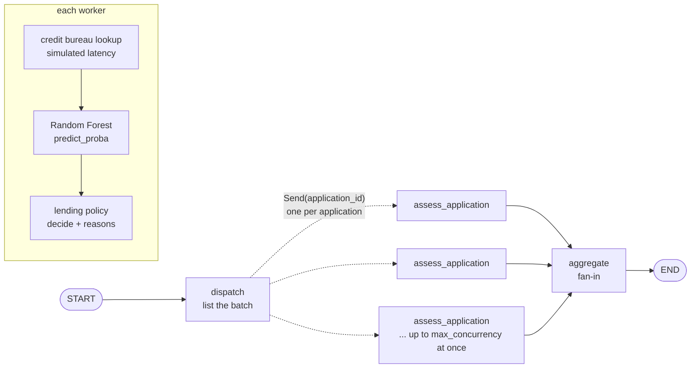
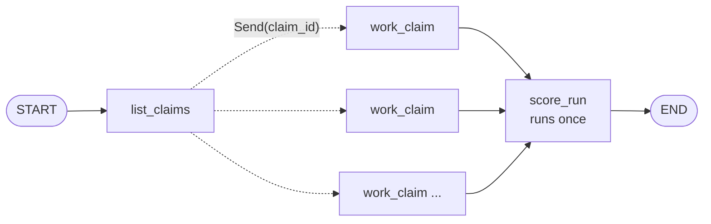
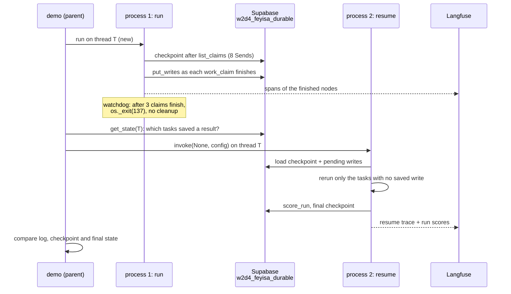

# Week 2 Day 4: Agent Swarms, by Feyisa Diba

The assignment from `labs/week2day4free.ipynb`, in three parts:

| Part | File | What it does |
|---|---|---|
| Commercial assignment | `loan_swarm.py` | Loan applications classified and decided concurrently: a Random Forest predicts default risk, a configurable lending policy approves, declines or refers, and LangGraph fans out and back in |
| Technical challenge | `score_dispatcher.py` | The lab's dispatcher with a `score_run` node after `work_claim` that scores the whole run once and keeps the scores in the graph's state |
| Stretch challenge | `durable_dispatcher.py` | That dispatcher made durable with `PostgresSaver` on Supabase, killed mid-run, resumed on the same thread, and checked against the checkpoint, the workers' log and Langfuse |

None of it calls an LLM. Everything uses synthetic data or the stand-in claim workers from the lab, so it costs no model requests.

This pull request carries the three modules and this README. The 33 tests and the measured results (`tests/` and `results/`) are on [the full branch in my fork](https://github.com/Feyisa-Diba/undercover/tree/feyisa_diba-week2day4-full/community_contributions/feyisa_diba/week2day4).

> **Educational prototype.** `loan_swarm.py` is a teaching exercise on synthetic data. It is not a lending system, and its model, thresholds and policy must not be used to make decisions about real people. See [Fairness, limitations and human review](#fairness-limitations-and-human-review).

## Running it

From this folder (`community_contributions/feyisa_diba/week2day4`), on Windows PowerShell or a Mac terminal:

```bash
# Commercial assignment. scikit-learn isn't one of the project's dependencies, so uv adds it for this run
# only, without touching pyproject.toml or uv.lock
uv run --with scikit-learn python loan_swarm.py
uv run --with scikit-learn --env-file ../../../.env python loan_swarm.py --langfuse   # traced in Langfuse

# Technical challenge
uv run python score_dispatcher.py

# Stretch challenge: needs DATABASE_URL (Supabase) in .env, and the Langfuse keys for tracing
uv run --env-file ../../../.env python durable_dispatcher.py demo            # both scenarios
uv run --env-file ../../../.env python durable_dispatcher.py traces          # read the sessions back from Langfuse
uv run --env-file ../../../.env python durable_dispatcher.py cleanup         # drop the demo's schema when you're done
```

The keys are read from `.env` at the root of the repo, which git ignores. Nothing here prints or saves a key: the files the runs write to `results/` hold only synthetic data, thread ids, trace ids and measurements.

The checkpoints go in their own schema, `w2d4_feyisa_durable`, never in the product's `undercover` schema. The demo opens one connection for each process, so at most two at a time against the free plan's 15.

## 1. Commercial assignment: loan decisioning

### Architecture



- **Data** (`make_applications`): seeded synthetic applications with annual income, loan amount, loan-to-income, years of credit history, debt-to-income, late payments in the last 12 months, prior defaults and on-time payment rate. A known logistic risk function plus noise sets the default label, so the model has real signal to find. `applicant_group` (A or B) is a synthetic stand-in for a protected characteristic, used only by the fairness audit.
- **Model** (`train_model`): a `RandomForestClassifier` (200 trees, depth 8, balanced class weights) trained on 75% of the applications and evaluated on the held-out 25%. It never sees `applicant_group` or the label. `n_jobs=1` keeps each prediction on its worker's thread.
- **Policy** (`LendingPolicy`, `decide`): every threshold is a field of a frozen dataclass. The rules run in order:
  1. Decline if debt-to-income is above the hard limit (65%), whatever the model says.
  2. Decline if the predicted default risk is at least 60%.
  3. Otherwise refer for a person's review if any of these hold: risk of 25% or more, debt-to-income above 45%, loan above 60% of income, a prior default, a loan of $60,000 or more, or under a year of credit history.
  4. Otherwise approve.

  Every decision carries its reasons as sentences, for example *"Predicted default risk 41% is between 25% and 60%"* or *"Loan of $72,000 needs a person's review at $60,000 or more"*.
- **Fan-out and fan-in**: `dispatch` lists the batch and a conditional edge returns one `Send` per application. All the `assess_application` tasks run in one superstep, with up to `max_concurrency` at once and a `RetryPolicy`. Their results go into `assessments`, which has an `operator.add` reducer. `aggregate` runs once after every worker has finished. It checks completeness (missing and duplicate ids) and works out the classification metrics against the held-out labels, the decision counts, the default rate within each decision and the fairness audit.
- **Consistency**: `compare` runs the same batch as a plain sequential loop and then through the graph with 3, 5 and 10 workers. It checks that every application's probability, decision and reasons, and the whole summary, are identical across all four.
- **Langfuse**: with `--langfuse`, each graph run is a trace named "Loan batch, N workers", all in one session. Each trace is scored with accuracy, precision, recall, F1, ROC AUC, seconds and whether the run was consistent.

### Results (measured November 26, 2026, on this Windows laptop)

2,000 applications: 1,500 to train, 500 held out and decided. The full output is in `results/loan_run.json` on the full branch.

**The model on the 500 held-out applications** (positive class: defaulted, threshold 0.5):

| accuracy | precision | recall | F1 | ROC AUC |
|---|---|---|---|---|
| 0.730 | 0.485 | 0.631 | 0.549 | 0.750 |

| | predicted repay | predicted default |
|---|---|---|
| **repaid** | 283 (true negative) | 87 (false positive) |
| **defaulted** | 48 (false negative) | 82 (true positive) |

**The policy's decisions**, with the share that actually defaulted:

| decision | applications | actual default rate |
|---|---|---|
| approve | 99 | 7.1% |
| refer | 280 | 21.1% |
| decline | 121 | 52.9% |

The policy sorts risk well. Approvals default at about a quarter of the batch's rate (26%), and declines at twice it. It also refers 56% of applications, so most of the batch still needs a person: see below.

**Timing**: the same 500 applications, as a plain loop and as a graph with 3, 5 and 10 workers:

| bureau latency | mode | workers | seconds | speedup | same decisions as sequential |
|---|---|---|---|---|---|
| none (CPU only) | sequential loop | 1 | 3.35 | 1.00× | yes |
| | LangGraph | 3 | 5.02 | 0.67× | yes |
| | LangGraph | 5 | 4.98 | 0.67× | yes |
| | LangGraph | 10 | 5.04 | 0.66× | yes |
| 50 ms per application | sequential loop | 1 | 30.98 | 1.00× | yes |
| | LangGraph | 3 | 11.34 | 2.73× | yes |
| | LangGraph | 5 | 7.39 | 4.19× | yes |
| | LangGraph | 10 | 6.13 | 5.06× | yes |

What this shows:

- **With nothing to wait for, more workers make it slower.** One Random Forest prediction is about 7 ms of Python and NumPy work, and Python threads share the GIL, so they take turns rather than running together. The graph's per-task bookkeeping is pure overhead on top. For a CPU-bound batch like this, score the whole batch in one vectorised `predict_proba` call, or use processes.
- **With I/O to wait for, the workers overlap.** Each application waits 50 ms on its bureau lookup, and threads wait in parallel. Three workers give 2.7×, close to the ideal 3×. Ten give 5×, not 10×, because the roughly 3–5 s of CPU work (and the GIL) sets a floor. As in the lab, the slowest part sets the clock.
- **Concurrency never changed an answer.** Every run produced the same probabilities, decisions, reasons and summary, at every level. The tests check this as well.

### Fairness, limitations and human review

**Fairness considerations**

- The model never sees `applicant_group`, but leaving a protected characteristic out of the features doesn't make a model fair. In this data group A's incomes are a little higher, and income, debt and history can act as proxies. So `aggregate` audits the outcome, not just the inputs: the approval, decline and actual default rates for each group, and the ratio of the lower approval rate to the higher.
- In the measured run, group A was approved 18.7% of the time and group B 21.4%, a ratio of 0.88. That's above the 0.8 "four-fifths" rule of thumb often used to flag adverse impact. Group B also defaulted more (32% against 22%), so a parity of approval rates isn't the only fairness measure to look at. Error rates by group (equal opportunity, false positive rates) and calibration by group matter too, and this prototype doesn't compute them.
- One synthetic batch with one seed proves nothing about fairness in general. A real audit needs real outcomes, legally defined protected classes, statistical tests with confidence intervals, a review of proxy features, and a compliance and legal review of adverse-action explanations (in the US, ECOA/Regulation B and FCRA).

**Model limitations**

- The data is synthetic, and the default label comes from a formula we chose. The model learns that formula back, so its metrics say nothing about real borrowers.
- Precision is 0.49: about half of the applications it predicts will default would in fact repay. A threshold of 0.5 with balanced class weights trades precision for recall, and the right trade-off depends on what a missed default and a wrongful decline each cost.
- The probabilities aren't calibrated. A Random Forest with balanced class weights over-states risk, so the policy's 25% and 60% thresholds are relative scores, not true probabilities. A real system would calibrate them, for example with isotonic regression, and check calibration on fresh data.
- There's no handling of drift, missing values, thin-file applicants (the policy refers those with under a year of history), fraud, or applications outside the training range.
- The reasons are the policy's rules, plus the model's risk as a single number. They don't explain why the model gave that risk. A real adverse-action notice needs per-feature reasons, for example from SHAP values, checked to be accurate.

**Human review**

- Every `refer` goes to a person. That's 56% of this batch, by design: the automated path is only for clear-cut cases.
- Large loans ($60,000 and up), prior defaults and thin credit files are always referred, whatever the model says.
- In a real deployment a person should also review automated declines before the applicant is told, sample approvals for quality, and own changes to the thresholds. The policy thresholds here are illustrative, not calibrated to any lender's risk appetite.

## 2. Technical challenge: `score_run`



`build_dispatcher(worker, claim_ids, labels, ...)` builds the lab's graph with one more node. The edge `work_claim → score_run` means: once every `work_claim` task in the superstep has finished, run `score_run` once. LangGraph runs the whole fan-out as one superstep, so `score_run` waits for the slowest claim, then sees every result, merged by the `operator.add` reducer. It works out the lab's scores (`decision_accuracy`, `accuracy`, `cost_of_mistakes`, `straight_through`, `seconds`, `slowest_claim`, `seconds_per_claim`, and `claims`), as plain floats so a checkpointer can save them, and returns `{"scores": ...}` into the state.

It's tested with the lab's stand-in, `make_stand_in`, which answers as the handler did except on the claims you tell it to get wrong (it refers those). The tests check that `score_run`:

- runs exactly once, after the last worker finished
- gives the scores you'd expect for a known set of wrong answers
- gives the same scores at 1, 5 and 25 at once
- still runs once, with one result per claim, when a worker fails and is retried

`uv run python score_dispatcher.py` runs all 25 harder claims, with 3 wrong, at 1, 5 and 25 at once. The scores came out the same at every level, and only the time changed:

| at once | decision_accuracy | accuracy | cost_of_mistakes | straight_through | seconds |
|---|---|---|---|---|---|
| 1 | 0.88 | 0.88 | $150 | 0.64 | 25.0 |
| 5 | 0.88 | 0.88 | $150 | 0.64 | 5.0 |
| 25 | 0.88 | 0.88 | $150 | 0.64 | 1.0 |

The 3 wrong answers are needless referrals, at $50 each.

## 3. Stretch challenge: durable execution on Supabase

### Architecture



- The dispatcher is `score_dispatcher.build_dispatcher`, unchanged, compiled with a `PostgresSaver`. Like the product's harness, it connects with `autocommit`, `prepare_threshold=0` for Supabase's pooler, and a `search_path`. Runs use `durability="sync"`.
- Each run happens in a **separate child process**, so the crash is real: a watchdog thread calls `os._exit(137)` once three claims have finished. That skips `finally` blocks, flushes and connection closes, as a kernel restart or an out-of-memory kill would.
- Every worker appends `start` and `finish` events, with its process id, to a JSONL log, and fsyncs each line, so we know what each process actually did.
- Between the two processes the parent reads the checkpoint with `get_state`. Each `Send` is a task whose path holds its index into the claims list, and a task with `result` set saved its writes before the crash.
- The second process runs `invoke(None, config)` on the **same thread id**. The checks then compare the two:
  - only the tasks with no saved write were run again, and no saved one was
  - every claim has exactly one result, with no duplicates
  - `score_run` ran exactly once
  - the scores cover every claim
- Both processes trace into one Langfuse session, `durable-dispatch <thread id>`. Just before the kill the watchdog flushes Langfuse, as a running exporter would have sent spans already. The resume trace gets the run's scores.

### Results (measured November 26, 2026)

8 harder claims, killed after 3 finished. The full output is in `results/durable_run.json` and `results/langfuse_traces.json` on the full branch.

| | capped: `max_concurrency=2` (the lab's setting) | uncapped: `max_concurrency=8`, claims finishing one by one |
|---|---|---|
| finished before the kill (log) | CLM-1201 … 1204 (4) | CLM-1201 … 1203 (3) |
| in flight at the kill | CLM-1205, 1206 | CLM-1204 … 1208 (5) |
| never started | CLM-1207, 1208 | none |
| **saved in the checkpoint** | **none** | **CLM-1201, 1202, 1203** |
| finished but lost | CLM-1201 … 1204 | none |
| worked again on resume | all 8 | CLM-1204 … 1208 (5) |
| every claim has one result, no duplicates | yes | yes |
| `score_run` ran once, scores cover all 8 | yes | yes |
| Langfuse: killed run's trace | `list_claims`, `fan_out`, 4 × `work_claim`, no root span | `list_claims`, `fan_out`, 3 × `work_claim`, no root span |
| Langfuse: resume trace | root, 8 × `work_claim`, 1 × `score_run` | root, 5 × `work_claim`, 1 × `score_run` |

The live tests ran both scenarios again and got the same pattern.

### Which claims does LangGraph work again?

**The rule:** after a crash, LangGraph resumes from the last checkpoint, the one taken after `list_claims`. It reruns every `work_claim` task that has no saved write. A task that finished and whose write reached Postgres is not run again. Its result comes back from `checkpoint_writes`, so the final state has every claim exactly once.

**The catch we found:** with `max_concurrency=2`, the four claims that had finished were lost anyway and were redone. LangGraph hands each finished task's writes to a background executor, and that executor comes from `get_executor_for_config(config)`, the same thread pool that `max_concurrency` sizes. When 8 `Send`s go into a pool of 2 threads, the 6 waiting `work_claim` tasks queue ahead of the finished tasks' `put_writes`. Those writes would only reach Postgres once the last claim had started. With the cap at 8, the writes didn't wait behind queued work, and every finished claim was saved. We checked this directly: after a capped run was killed with 3 claims finished, `checkpoint_writes` held 0 `results` rows, and after an uncapped run, 3.

What it means for the product:

- **A claim can be worked twice after a crash.** With a cap below the batch size, that can happen even to claims that had finished. The lab and the product make this safe by making the side effects idempotent: a decision, once recorded, is final, and the backend refuses a different one. A durable fan-out needs idempotent workers. Checkpoints alone aren't enough.
- **Finished work that hasn't been checkpointed is lost.** In the product each claim runs on its own thread, so a crash loses at most the claim in flight, which is one more reason for the design in the lab's note "One thread here, a thread for each claim in the product".
- **The logs had a lesson too.** On Windows, appending to a file from several threads at once isn't atomic. Our first runs lost some `start` lines until `log_event` took a lock. The checkpoint was right throughout; only our own evidence was wrong.

## Tests

The tests are on [the full branch](https://github.com/Feyisa-Diba/undercover/tree/feyisa_diba-week2day4-full/community_contributions/feyisa_diba/week2day4/tests). `tests/` has 33 tests: 31 run offline, and 2 run the live demo against Supabase when `DATABASE_URL` is set.

- `test_loan_swarm.py` (21):
  - the data is seeded and the train and test sets don't overlap
  - the protected attribute and the label aren't features
  - the model beats chance (ROC AUC above 0.6)
  - every policy rule gives the right decision and reason, and the policy is configurable
  - the graph decides every application exactly once
  - predictions are identical to sequential at 3, 5 and 10 workers
  - `max_concurrency` caps the overlap
  - workers beat sequential when they wait on I/O
- `test_score_dispatcher.py` (6): `score_run` runs once, after the last worker, and stores the scores; the scores are right; they don't depend on concurrency; a retry still gives one result per claim and one `score_run`.
- `test_durable_dispatcher.py` (4 + 2 live):
  - with `InMemorySaver` and a worker that fails, resuming on the same thread reruns only the failed claim, with no duplicates and one `score_run`
  - a new thread starts from scratch
  - the analysis catches a saved task being rerun
  - the log round-trips
  - live: both kill-and-resume scenarios on Supabase pass every check, and the uncapped one loses no finished work

Measured run, November 26, 2026, from this folder on the full branch. `--no-cov` is needed because the project's pytest settings measure coverage of `backend/` and `agent/` only, with an 80% floor.

```
uv run --with scikit-learn pytest tests --no-cov                            # DATABASE_URL unset
31 passed, 2 skipped in 8.40s
uv run --with scikit-learn --env-file ../../../.env pytest tests --no-cov
33 passed in 43.60s
```

## Files

In this pull request:

```
week2day4/
├── README.md
├── loan_swarm.py            commercial assignment
├── score_dispatcher.py      technical challenge
└── durable_dispatcher.py    stretch challenge
```

Also on the full branch: `tests/` and `results/`. The results folder holds `loan_run.json` (the measured loan run), `durable_run.json` (the measured kill-and-resume runs), `durable_log_*.jsonl` (the workers' logs from those runs) and `langfuse_traces.json` (the spans Langfuse holds for each session).
