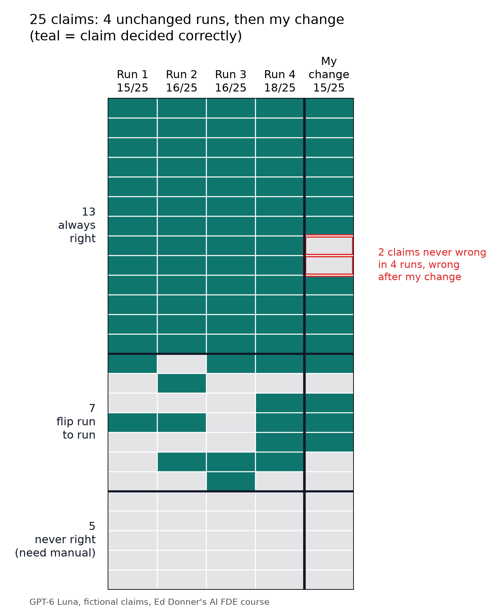

# Week 1 Day 2: is my change better, or is it noise?

By Syed Abdul Rasheed.

I extended the Day 2 claims agent (GPT-6 Luna, low reasoning, `get_policy` and `record_decision`). Then I changed it, moving baggage payout arithmetic into code and rendering the displayed amount from the saved decision. The changed agent scored 15/25 against 18/25 for a fresh baseline.

Before calling that a regression I compared it against four unchanged runs: same model, prompt, 25 claims and scoring. They scored 15, 16, 16 and 18, so a 3-point drop is inside the run-to-run noise.

## Claim by claim

| Across 4 unchanged runs | Claims |
|---|---|
| Always right | 13 |
| Always wrong (all five manual cases) | 5 |
| Flipped between runs | 7 |

The changed agent got two of the 13 always-right claims wrong. Those are the failures worth reading:

- CLM-1013 (trip delay): the rationale says the delay does not meet the 12-hour waiting period, and the agent saved an approval anyway.
- CLM-1012 (baggage): the agent called the new baggage approval tool with decline arguments, failed validation and never saved a decision.

Neither involved the arithmetic itself; both touch the tools and instructions I changed around it. The CLM-1012 failure is directly tied to the new tool. CLM-1013 could still be a rare slip, since four runs cannot prove a claim is stable. The score alone could not separate either from noise.



## Try it on your own runs

`claim_stability.py` takes a CSV with `claim_id` and one 0/1 column per run, the changed run last. It lists always-right claims that now fail and always-wrong claims that now pass, and separates out the flipping claims. Treat those lists as claims to inspect, not proof: more baseline runs make them more trustworthy. `claim_results.csv` is my data.

```
uv run python claim_stability.py claim_results.csv
```

## Limits

This is one run of the changed agent, on development claims only, with provider routing and caching not controlled. The fourth baseline run came from a later version of my runner, with the baseline path unchanged. All my experiments together cost under 7 cents.
